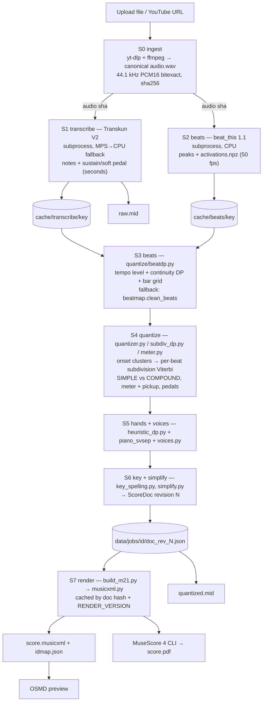
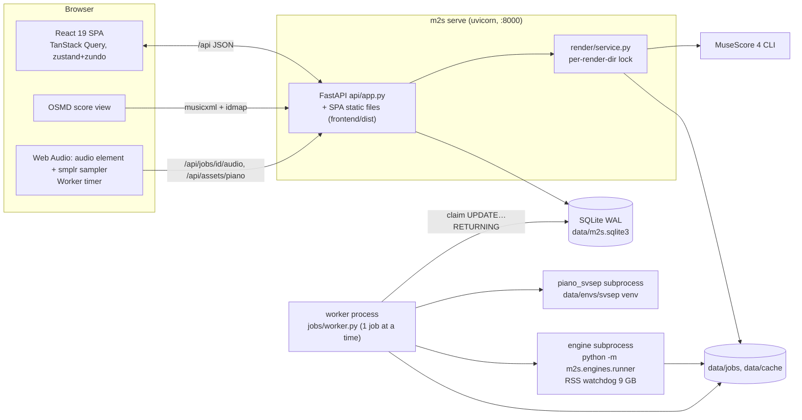
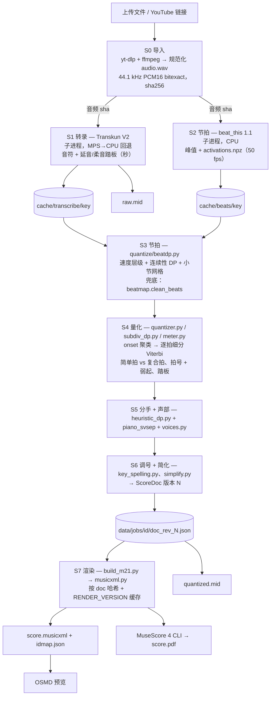
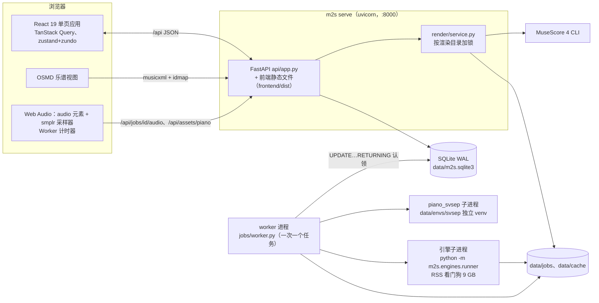

# music2sheet — Architecture

**Languages / 语言:** [English](#english) · [简体中文](#简体中文)

> Status: Phase 0 (solo piano), as of 2026-10-25. Every statement below is based on the code in
> `backend/src/m2s/**` and `frontend/src/**`, the ADRs in `docs/adr/` and `docs/evaluation.md`.
> When code and this document disagree, the code wins. Please update this file in the same change.

---

<a id="english"></a>

# English

## Contents

1. [Purpose, principle and scope](#1-purpose-principle-and-scope)
2. [End-to-end workflow](#2-end-to-end-workflow)
3. [Technology stack](#3-technology-stack)
4. [Core logic in depth](#4-core-logic-in-depth)
5. [API reference](#5-api-reference)
6. [Evaluation and quality gates](#6-evaluation-and-quality-gates)
7. [Repository, data, configuration, running](#7-repository-data-configuration-running)
8. [Known limitations and roadmap](#8-known-limitations-and-roadmap)

## 1. Purpose, principle and scope

music2sheet turns a piano recording, either an uploaded file or a YouTube URL, into an editable grand-staff score. It exports the score as PDF, MusicXML and MIDI.

**Product principle: AI first draft, then human fine-tuning.** The pipeline does not try to produce a perfect score. It produces a *consistent, readable* first draft fast, and the browser editor makes correcting it cheap:

- the recording plays against the score, with score following;
- notes can be dragged on a piano roll;
- any automatic decision (hands, voices, spelling, key) can be re-run, and user-locked properties are kept;
- quantization can be regenerated with different *priors* (key, BPM, time signature, grid, simplification level) in seconds, because transcription and beat tracking are cached.

| Aspect | Phase 0 decision | Source |
|---|---|---|
| Scope | Solo piano only. No source separation, no other instruments, no vocals | README, ADR 0001 |
| Deployment | Local, single user, no auth, no Celery/Redis | ADR 0001 |
| Hardware target | Apple Silicon M4, 16 GB unified memory, so only one ML model is in memory at a time | ADR 0001, `jobs/worker.py` |
| Source of truth | `ScoreDoc` JSON (ticks, PPQ 960). Preview, PDF, MusicXML and MIDI are all derived deterministically from it | ADR 0001, `models/scoredoc.py` |
| Score per piece | One key signature, one time signature and one tempo level for the whole piece | README, ADR 0004/0006 |

## 2. End-to-end workflow

### 2.1 User flow

1. **Upload / YouTube** (`frontend/src/components/UploadCard.tsx`): upload an audio file (`.wav .mp3 .flac .m4a .aac .ogg .opus .aiff .aif .webm .mp4`; `AUDIO_EXT` in `api/app.py`) or paste a YouTube URL (downloaded with yt-dlp, which needs Deno; `ingest/youtube.py`). The maximum length is 15 min (`M2S_MAX_AUDIO_S`).
2. **Priors** (`components/PriorsForm.tsx`, `models/priors.py`). All are optional: key, BPM, time signature, minimum grid (1/8, 1/16, 1/32), triplets on/off, style (classical/pop) and simplification level (0 faithful, 1 readable, 2 simplified). New jobs default to level 1 (`NEW_JOB_SIMPLIFY` in `api/app.py`).
3. **Job progress** (`pages/JobPage.tsx`): TanStack Query polls `GET /api/jobs/{id}` every 1 s while the job is `queued` or `running`. It shows the stage and progress (the stage ranges are in `STAGE_RANGE`, `jobs/worker.py`). A running job can be cancelled.
4. **Editor** (`editor/EditorLayout.tsx`): the OSMD score view on top, the canvas piano roll below, and the Inspector, Toolbar and Transport. Edits autosave 600 ms after the last change and create a new revision.
5. **Playback and following** (`editor/Transport.tsx`, `scorePlayer.ts`, `scoreFollow.ts`). There are four modes: 原始录音 (recording), 乐谱合成 (score synth), 叠加对照 (overlay) and 左原音右乐谱 (split L/R). While playing, the sounding noteheads turn green, a band marks the current measure, a cursor marks the beat, and the view auto-scrolls. Double-click a note to seek.
6. **Rerun / simplify / tempo ×2 ÷2** (`editor/Toolbar.tsx`): these change the job's priors and call `POST /rerun`. S1/S2 come from the cache, so the new revision appears in a few seconds. If the doc was hand-edited, the editor asks for confirmation first; older revisions stay on disk.
7. **Export**: PDF (MuseScore), MusicXML, quantized MIDI or raw (performance) MIDI.

### 2.2 Processing pipeline (S0–S7)



| Stage | Code | Input → output | Cached? |
|---|---|---|---|
| S0 ingest | `ingest/audio.py`, `ingest/youtube.py` | source file/URL → `audio.wav` (44.1 kHz, stereo, PCM16, `-bitexact`, metadata stripped). Its sha256 is the content key | no (fast) |
| S1 transcribe | `engines/transkun_eng.py` | wav → `Transcription` (`NoteEvent` onset/offset seconds, velocity; `PedalEvent` sustain/soft/sostenuto). Offsets are physical key releases ("finger durations") | **yes** |
| S2 beats | `engines/beatthis_eng.py` | wav → `BeatGrid` (peak-picked beats/downbeats, no DBN) + `activations.npz` (beat/downbeat logits, 50 fps) | **yes** |
| S3 beats | `quantize/beatdp.py`, `pipeline/stages.py:s3_beats` | activations + note onsets + priors → one consistent beat list, regular downbeats, bpm, level confidence | no |
| S4 quantize | `quantize/quantizer.py`, `subdiv_dp.py`, `meter.py`, `beatmap.py` | notes + beats → `ScoreDoc` with ticks, meter, pickup, pedals, tempo map (staves unassigned) | no |
| S5 hands/voices | `pipeline/rederive.py:arrange_hands`, `hands/*` | staff 1/2 and voice 1–2 per note | no |
| S6 key/simplify | `pipeline/stages.py:s5_s6_arrange`, `notation/key_spelling.py`, `notation/simplify.py` | key estimate (or prior), notes with velocity < 10 dropped (`MIN_VELOCITY`), optional simplification → ScoreDoc rev N | no |
| S7 render | `render/service.py`, `notation/build_m21.py`, `render/musicxml.py`, `render/pdf_mscore.py` | ScoreDoc → MusicXML + idmap (+ PDF, MIDI on demand) | yes, per doc hash |

**Caching** (`pipeline/cache.py`). The cache key is `sha256(stage, STAGE_VERSIONS[stage], canonical params {engine, engine version}, upstream keys)[:24]`, and the upstream key is the canonical audio's sha256. Each entry is a directory `data/cache/<stage>/<key>/` holding `artifact.json` (plus `activations.npz` for beats) and `meta.json`. Entries are written atomically: the stage builds into a temp dir, then renames it.

Only S1 and S2 are cached. They are the expensive ML stages (about 15 s for 3 min of audio on MPS for Transkun, about 2 s for beat_this). S3–S6 are pure Python, take under about 1 s, and depend on each other (for example, the simple/compound decision needs the quantization fit), so caching them separately is not worth it (ADR 0001).

To invalidate cached outputs, bump `STAGE_VERSIONS` (`beats` is now 2 because it also saves the activations, ADR 0006). Renders are cached separately under `data/jobs/<id>/render/<doc_hash>/`. `doc_hash` hashes the doc without `revision`/`provenance` together with `RENDER_VERSION` (currently 4, `jobs/store.py`), so an undo back to an earlier state reuses its render.

### 2.3 Job execution model



- **Job table** (`jobs/db.py`): one SQLite table `jobs` in WAL mode. Status is `queued | running | done | error | cancelled`; the row also holds `stage`, `progress`, `message`, `params_json` (the Priors), `audio_sha`, `duration_s`, `doc_rev` (latest revision on disk) and `error`. The worker claims the oldest queued row atomically with `UPDATE … WHERE id = (SELECT …) RETURNING *`. On startup `requeue_stale()` puts rows left `running` by a crashed worker back in the queue.
- **Single worker** (`jobs/worker.py`): `m2s serve` starts it as a child process (`python -m m2s.cli worker`) unless `--no-worker` is given. It polls every 0.5 s and runs one job at a time on purpose, because of the 16 GB memory. Cancellation is cooperative: every progress callback re-reads the row, raises `Cancelled` when the status is `cancelled`, and that kills the engine subprocess.
- **ML engines in subprocesses** (`engines/runner.py`, `engines/base.py`): each ML stage runs `python -m m2s.engines.runner ENGINE AUDIO OUT --device D`. Progress arrives as JSON lines on stdout. A watchdog thread kills the process if its RSS exceeds `M2S_ENGINE_RSS_LIMIT_GB` (default 9). The timeout is 1800 s. Model memory is freed when the process exits, and a crash cannot take down the worker.
- **MPS/CPU fallback** (`pipeline/stages.py:_engine_stage`): Transkun runs on `mps` by default (identical output to CPU, about 1.37× faster, 3.65 GB). If an `EngineError` occurs on a non-CPU device, the stage is retried on CPU. beat_this runs on CPU (about 2 s, results identical to MPS).
- **Reruns** (`POST /api/jobs/{id}/rerun`): the row's params are replaced and the job is re-queued. The worker runs the whole `run_job` again, but S1/S2 are cache hits, so only ingest and S3–S7 do real work. The new doc gets `doc_rev + 1`.

## 3. Technology stack

Versions are taken from `backend/uv.lock`, `frontend/pnpm-lock.yaml` and the installed MuseScore. Licences are the upstream projects' published licences; check them again before redistributing anything.

| Component | Version | Licence | Role / why chosen |
|---|---|---|---|
| Python (uv-managed) | 3.11 | PSF | music21 10 needs ≥ 3.11 (ADR 0001) |
| **Transkun V2** | 2.0.1 | MIT | Piano transcription with sustain/soft pedal. Note onset F1 0.983 on MAESTRO; 3 min of audio in about 15 s on MPS. Chosen over basic-pitch (F1 0.72, ADR 0002) |
| **beat_this** (CPJKU) | 1.1.0 | MIT | Beat and downbeat activations, used without its DBN. The frame logits feed our own DP (ADR 0006) |
| **piano_svsep** (CPJKU, ISMIR 2024) | commit `1462e7c` | MIT | GNN staff prediction: 0.928 vs 0.886 for the heuristic (ADR 0003). Lives in its own venv `data/envs/svsep` (torch 2.8 + partitura 1.8 + torch-scatter, installed by `scripts/setup_svsep.sh`) |
| torch | 2.14.1 | BSD-3 | Runtime for Transkun and beat_this |
| **music21** | 10.5.0 | BSD-3 | Builds the MusicXML score. We export with `makeNotation=False` and generate the notation ourselves (render 1.5 s → 0.4–0.5 s, ADR 0001) |
| partitura | 1.9.0 (main env) / 1.8 (svsep venv) | Apache-2.0 | Used inside the svsep venv to parse our MusicXML for piano_svsep. It is a main-env dependency, but `m2s` itself does not import it |
| pretty_midi / mido | 0.2.11.post0 / 1.3.3 | MIT | Raw and quantized MIDI export |
| lxml | 6.1.3 | BSD | Strict MusicXML validator (`render/validate.py`) |
| **MuseScore 4 CLI** | 4.7.5 | GPL-3.0 (run as an external program) | MusicXML → PDF. Success means a fresh, non-empty file, because rc 134 at exit is a known quirk (ADR 0001) |
| ffmpeg / ffprobe | Homebrew | LGPL/GPL (external) | Decoding and normalization |
| yt-dlp (+ Deno) | 2026.8.19 | Unlicense | Optional YouTube input |
| **FastAPI** + uvicorn | 0.143.0 / 0.54.0 | MIT / BSD | Local API that also serves the built SPA |
| pydantic / pydantic-settings | 2.14.0 / 2.15.0 | MIT | Data models (ScoreDoc, Priors, artifacts) and `M2S_*` settings |
| **SQLite** (WAL) | stdlib | public domain | Job table; no broker needed for a single user |
| typer | 0.27.3 | MIT | `m2s` CLI |
| mir_eval / remotezip | 0.8.2 / 0.12.6 | MIT | Evaluation (optional `eval` extra) |
| **React** | 19.3.0 | MIT | UI |
| **Vite** | 8.3.4 | MIT | Dev server (proxies `/api` to :8000) and build |
| TypeScript | 7.0.2 | Apache-2.0 | Type checking |
| **Tailwind CSS** | 4.3.3 | MIT | Styling |
| **zustand + zundo** | 5.0.15 / 2.3.0 | MIT | Editor store with undo/redo (`editor/store.ts`) |
| **TanStack Query** | 5.104.1 | MIT | Server state, job polling |
| react-router-dom | 7.18.4 | MIT | `/` and `/jobs/:id` |
| **OpenSheetMusicDisplay** | 2.2.0 | BSD-3 | In-browser MusicXML rendering (preview only; never the source of truth) |
| **smplr** | 1.1.0 | MIT | SplendidGrandPiano sampler. The samples are public domain (ADR 0005) |
| **Playwright** (Python) | 1.63.0 | Apache-2.0 | E2E suites in `backend/tests/e2e/` |
| **uv** / **pnpm** | — | MIT/Apache / MIT | Python and JS package managers |
| ruff / pytest | — | MIT | Lint (line length 110) and tests |

## 4. Core logic in depth

### 4.1 ScoreDoc — the single source of truth (`models/scoredoc.py`)

- **Logical, not graphical.** One `ScoreNote` is one sounding note with its full duration. Barline splits, ties across barlines, rests, beams and tuplet brackets are *derived* at render time, so edits never touch them.
- **Time** is integer ticks at **PPQ = 960**, which is divisible by 3 for triplets and sextuplets. Tick 0 is the start of measure 1. Measure 1 is `pickup_ticks` long when that is > 0 (an anacrusis, written as `<measure implicit="yes" number="0">`).
- **ScoreNote**: `id, pitch, start, dur, staff (1 = RH, 2 = LH), voice 1–4, spelling (None = auto), tie_next, velocity, confidence, src_ids (transcription ids), locked ⊆ {pitch, time, staff, voice, spelling}`.
- **Document level**: `meters` and `keys` (each must start at tick 0; a meter change must sit on a barline), `tempos` (`TempoMark.bpm` always counts *quarter notes*, ×1.5 for dotted-quarter beats), `clefs`, `pedals` (`ScorePedal`), `tempo_map` (`TempoMap`: one (tick, seconds) anchor per beat, piecewise-linear in both directions, which is what lets the recording and the score stay in sync), `engraving`, `provenance`.
- **Locks.** The Inspector and editor actions lock any property the user changes by hand. `rederive` (hands, voices, spelling, key), svsep refinement and simplification never override a locked property or drop a locked note.
- **Revisions.** Each save writes `doc_rev_<N>.json`. `PUT /doc` is an optimistic lock: the body's revision must equal the job's `doc_rev`, otherwise the server answers 409. The server sets `provenance.versions.edited = "1"`, which the toolbar uses to warn before a rerun.
- **Engraving flags** (`Engraving`). They change only how the score is printed, never what sounds:
  - `pedal_marks`: every Ped./✱, or a single "con Ped.";
  - `ottava`: 8va/8vb brackets;
  - `tidy`: whole-beat value grouping, and dropping the bracket from repeated triplet groups.
- **Provenance** `versions` records decisions for the UI: `beats` (dp/legacy), `tempo_level_bpm/source/confidence/prior`, `min_grid`, `hands` (heuristic/piano_svsep), `simplify`, `simplify_meter`, `edited`.

### 4.2 Beat tracking: tempo-continuity DP (`quantize/beatdp.py`, ADR 0006)

The problem: beat_this's peak-picked beats switch metrical level inside a piece. Call of Silence jumps between 30, 60, 130 and 270 BPM, with 27.6% of inter-beat intervals changing by more than 25%. The DP fixes one level for the whole piece.

1. **Tempo-level selection** (`_candidate_bpms`, `_score_level`, `_rescore`).
   - Candidates: the 3 peaks of the tracker's local-tempo histogram plus 2 autocorrelation peaks, each at ×½, ×1 and ×2, within `BPM_RANGE` 28–260.
   - Each candidate is tracked with the DP and scored on:
     - the F-measure of its beats against the activation peaks (weight 8 when the best F ≥ 0.9, sliding down to 2 when F ≤ 0.8, so the priors decide when the tracker itself is ambiguous);
     - the share of downbeat peaks that land on its beats (`DOWNBEAT_FIT_W` 3);
     - a level-mixing penalty (`MIX_W` 4 × the share of beats more than 0.4 octave from the median);
     - a log-normal **tempo prior** (median 105 BPM, σ 0.77 octave);
     - a log-normal prior on **rhythmic events per beat** (median 3.56; σ 0.6 octave below, 1.0 above). Both priors were fitted on 356 ASAP performances.
   - The **confidence** is the margin over the best candidate at a different level, mapped to 0–1.
2. **DP tracking** (`dp_track`, Ellis-style).
   - Reward: beat activation + 0.35 × downbeat activation − 0.3.
   - Penalties: interval change 4·log², distance from the target period 1.5·log².
   - Hard limits: intervals within 0.6–1.67× the target, and at most 1.4× change from one beat to the next.
   - Drift and rubato are allowed; octave jumps are not. It is vectorised in blocks, takes about 15 ms per candidate for 6 min of audio, and all of S3 takes about 0.1 s.
3. **BPM prior.** A user BPM skips level selection and becomes the DP target. The DP still settles on the nearest tempo the music supports. That is how the toolbar's **速度 ×2 / ÷2** works: it reruns with `priors.bpm` doubled or halved. ÷2 is disabled when the halved tempo would fall below 40 BPM, or when no tempo is known (`HALF_MIN_BPM`, `Toolbar.tsx`).
4. **Bar grid** (`choose_bar_grid`). The downbeat activation is sampled at the new beats, and the contrast (bar positions minus others) is computed for 2, 3 and 4 beats per bar and every phase. 4 is preferred over 2 when the contrast ratio ≥ `FOUR_VS_TWO` = 0.73.
5. **Bar-phase repair** (`repair_bar_phase`, 3 and 4 beats per bar). A Viterbi over position-in-bar may "stay" (delete the weaker extra beat) or "skip" (insert a missing beat) at a cost of 2.0 each. It typically makes 0–4 fixes per piece.
6. **Automatic finer grid** (`_grid_for_level`, `stages.py`). If the DP level is below 80 BPM, the tempo is steady (median step < 0.05 octave) and the grid is the default 1/16, S4 uses 1/32.
7. **Fallback.** Without activations (old cache entries, synthetic ASAP evaluation), or with fewer than 8 DP beats, S3 uses `beatmap.clean_beats`: it fills 2×/3× gaps, drops 0.5× gaps and applies the BPM prior octave fix. The result is bit-identical to the pre-DP pipeline.

### 4.3 Quantization (`quantize/quantizer.py`, `subdiv_dp.py`, `beatmap.py`)

1. **BeatMap**: a piecewise-linear map between seconds and fractional beat index, extended past both ends with the median edge interval.
2. **Onset clustering** (`cluster_onsets`): onsets within `tol` of a cluster's first onset form one event. `tol` = 0.35 × (finest grid unit in seconds), clamped to 25–60 ms.
3. **Per-beat subdivision Viterbi** (`choose_subdivisions`). For each beat the candidates are the model's native divisions up to the grid level (1/8 → level 1, 1/16 → 2, 1/32 → 3) plus tuplets when triplets are on. The local cost has four parts:
   - the squared timing error relative to a tolerance (8% of the beat, 25–50 ms), capped at 4 per onset;
   - a **collision cost** when distinct onsets merge onto one grid point;
   - the **complexity cost** of the division: SIMPLE `{1:0, 2:0.3, 4:1, 8:2.5, 3:1.8, 6:8}`, COMPOUND `{1:0, 3:0.3, 6:1, 12:2.5, 2:1.8, 4:4}`, with the first tuplet × 0.7 for the classical style;
   - the **unrepresentative-grid rule**: a grid finer than the onsets need (for example ÷6 when only {0, 3/6} occur) costs 1e6, so it can never stand in for the coarser division.

   Transitions cost 0.4 within a family and 1.5 between native and tuplet families, which keeps the rhythm consistent from beat to beat.
4. **SIMPLE vs COMPOUND model selection.** If there is no time-signature prior, both models are fitted at the finest level (÷8 vs ÷12). COMPOUND wins only if `cost_compound + COMPOUND_BIAS (0.8) × busy_beats < cost_simple`. For slow beats (> 1.25 s), the comparison is repeated on a half-beat grid, so that a slow 4/4 is not turned into 12/8.
5. **Meter and pickup** (`meter.py:infer_meter`). Tracker downbeats are never trusted one by one. The regular (beats per bar, phase) grid that best agrees with them wins (F-measure plus a small prior, `PRIOR_BONUS` 4: +0.03, 2: −0.02). If agreement is below 0.3, the meter defaults to 4/4. COMPOUND turns 2/3/4 beats into 6/8, 9/8 and 12/8. A time-signature prior only chooses the phase. Pickup = (phase − first beat) mod beats per bar.
6. **Ticks and offsets.** Onsets come from the snapped grid positions. Offsets snap to the grid of the beat they land in (`snap_to_beat_grid`, floor ÷2). A note lasts at least one grid unit. Same-pitch overlaps are truncated (`_resolve_same_pitch_overlaps`). Note confidence = 1 − 0.5·min(err/120 ms, 1), minus 0.3 when velocity < 20. Low-confidence notes show in orange in the editor.
7. **Pedals** (`_quantize_pedals`). They snap to quarter-beat units, re-pedalling abuts the previous span, and pedals shorter than half a beat are dropped. **Notes are never lengthened by the pedal**: pedals stay separate `ScorePedal`s, and the notation uses finger durations.
8. **Legato under pedal** (`hands/voices.py:_legato_snap`). Inside a voice, a gap to the next chord is closed when it is smaller than ¼ beat or covered by the sustain pedal. This brought visible rests from 22.6 to 2.5 per 100 notes on Call of Silence (ADR 0005).
9. **Tempo map and tempo mark.** There is one anchor per beat. The bpm is the beat tempo (`beat_tempo`: the median of 8-beat averages) × beat ticks / PPQ.

### 4.4 Hand separation and voices

- **Heuristic DP** (`hands/heuristic_dp.py`). A Viterbi over onset clusters, where each cluster is split into "lowest j notes → LH, the rest → RH". The costs are:
  - infeasible: a hand spanning more than its maximum span, or more than 5 notes;
  - soft register zones (LH above 67 or RH below 53, 0.15 per semitone);
  - distance from each hand's smoothed centroid (α 0.3, starting at 48 and 72);
  - a crossing penalty of 2.0.

  Locked staves are kept.
- **piano_svsep refinement** (`hands/svsep.py`, ADR 0003).
  - The heuristic result is rendered to MusicXML and run through `engines/svsep_predict.py` inside the svsep venv (about 5 s, mostly start-up).
  - The predicted staff of each fragment is mapped back by **(absolute onset tick, pitch)**. partitura renumbers note ids and counts quarters from the first downbeat, so `pickup_ticks` is added.
  - Unlocked notes take the prediction, and voices are reassigned.
  - Any failure, or `M2S_HAND_MODEL=heuristic`, keeps the heuristic result. `provenance.versions.hands` records which model was used.
- **Voices** (`hands/voices.py`, at most 2 per staff).
  - A start-group whose durations differ by more than half a beat splits: the higher sub-chord goes to voice 1, the lower to voice 2.
  - Overlaps of up to half a beat are legato and get truncated.
  - Only a held note of ≥ 1 beat pushes a new chord into voice 2.
  - Finally, `_legato_snap` runs.

### 4.5 Key estimation and spelling (`notation/key_spelling.py`, ADR 0004)

- **Key**: correlation with the Temperley (Kostka–Payne) major and minor profiles, duration-weighted. The first and last 8 beats are weighted 3×. The minor key that could take 6 sharps or 6 flats is written as E♭ minor (6♭), not D♯ minor (6♯). Accuracy is 89.5% on full ASAP pieces, against 80.3% for Krumhansl–Kessler.
- **Spelling (line of fifths)**: diatonic pitch classes follow the key signature, the raised 7th in minor is a leading tone, and other chromatic notes take the spelling nearest the key centre on the line of fifths. Spelling is applied at render time unless `ScoreNote.spelling` overrides it.

### 4.6 Simplification levels (`notation/simplify.py`, ADR 0007)

`simplify(doc, level, onset_s, grid_level, offset_s)` rewrites the doc after S5. Re-snapping uses the **performed** times saved by S4 (`Ctx.perf_s`), not the faithful score's grid. Locked notes are never dropped or moved. Rerunning hands or voices on a level 1/2 doc calls `one_voice_per_staff` again.

| Level | What it does |
|---|---|
| **0 原样 faithful** | Returns the doc untouched; bit-identical to the pipeline before the option existed. The ASAP gate runs at this level |
| **1 易读 readable** (default for new jobs) | Drops ornaments (`_drop_ornaments`: fast 1–3 note turns or graces 1–3 semitones from an isolated main note, plus < 80 ms grace notes). Reduces chords (`_reduce_chords`): keeps top and bass, drops inner duplicate pitch classes and quiet short inner notes, at most 4 notes per hand. Re-snaps with `quantizer.requantize`: no sextuplets, triplets × 1.6 complexity, the finest native division costs 6 instead of 1 (÷4 on the default 1/16 grid) or 2.5 (÷8 on 1/32), onsets within 70 ms merged. **One voice per staff** (`_single_voice`, `_nice_end`, `_rest_reads_better`). Engraving: `pedal_marks=False` (one "con Ped."), `ottava=True` (8va/8vb seeds, extension and merge rules in `build_m21.ottava_spans`), `tidy=True`. Automatic clefs by a per-beat Viterbi (`_auto_clefs`): ledger cost l² + 15·max(0, l−3), 12 per switch, +8 mid-bar, +1 per bar away |
| **2 简化 simplified** | Everything in level 1, plus: RH keeps the melody (skyline) and at most one harmony note. The grid floor is a unit of at least 0.28 s (`_floor_level`), with no tuplets and one onset per grid point (`_one_onset_per_tick`). Anticipations are straightened (`_straighten`). The meter is rewritten to 6/8, 9/8 or 12/8 when off-beat onsets are mostly on triplet positions (`_to_compound`). LH becomes one block chord per harmonic window of about 1.8 s (bass plus two chord tones by duration × velocity, `_lh_blocks`) |

Playback and MIDI use the same simplified notes, but the pedals are kept.

### 4.7 Notation building (`notation/build_m21.py`) and rendering

- **Own duration decomposition** (`decompose`). For every (staff, voice, measure), a gap-free timeline of chords and rests is cut into values from `BINARY_VALUES` (4 … 1/16, including dotted values) or `TRIPLET_VALUES`. music21 is never asked to invent durations.
- **Ternary beats.** A beat is ternary when any boundary inside it falls on a triplet position. Every value inside it is then a triplet value, so each beat carries exactly one triplet bracket, or two half-beat brackets when it splits evenly (`_bracket_tuplets`). With `tidy`, a triplet group that repeats the previous one prints without bracket and "3".
- **Half-bar rule.** In even bars of ≥ 4 beats, a single value starting off the beat may not cross the middle of the bar. Plain values may cross beats (syncopation) only between binary positions. Pieces of one note are tied.
- **Hidden voice-2 rests.** Filler rests in secondary voices keep the timing but are hidden (`hideObjectOnPrint`).
- **Tempo marks** use a dotted-quarter referent in compound meters (bpm / 1.5). Pedals become `PedalMark`s or one "con Ped." text. Ottava spans and clef changes come from the engraving flags and `doc.clefs`.
- **idmap**. The key is `m{measure}|s{staff}|q{offset in quarters as n/d}|p{midi}`, mapped to the ScoreNote id, for every fragment. Voice is not part of the key because music21 renumbers voices.
- **Export** (`render/musicxml.py`): `score.write("musicxml", makeNotation=False)`. Post-processing strips `<encoding-date>`, sets `version="4.0"` and marks the pickup measure `implicit="yes"`, which makes the output deterministic.
- **Strict validator** (`render/validate.py:check_measures`). It mirrors MuseScore, which measures notes by `<type>`, `<dot>` and `<time-modification>`. Every voice must fill its bar (the implicit pickup may be shorter), and every tuplet note must sit inside a bracket. Tests and evaluations require a pass rate of 100%.
- **Render cache and locking** (`render/service.py`). `ensure_musicxml` writes `score.musicxml` and `idmap.json` under `render/<doc_hash>/`, with one lock per render dir, so the editor's two parallel requests render only once. `ensure_pdf` calls MuseScore (`render/pdf_mscore.py`; 60 s timeout; success means a fresh, non-empty PDF even with rc 134).
- **MIDI** (`render/midi_export.py`, `service.py:doc_to_midi`). `raw.mid` is the performance in seconds, including pedal CCs. `quantized.mid` uses the doc's ticks at `tempos[0].bpm`, with RH and LH as separate tracks and pedals as CC 64/66/67.

### 4.8 Editor (`frontend/src/editor/`)

- **Store** (`store.ts`, zustand + zundo `temporal`). It holds the doc, `baseRev`/`savedRev`, `saveState` (saved, dirty, saving, error, conflict), selection, grid, playhead, `playing` and `follow` (stored in localStorage under `m2s.follow`). Only `doc` is undoable (history limit 200). The server revision lives outside the history, so undo never sends a stale revision.
- **Autosave** (`EditorLayout.tsx`): a 600 ms debounce, then one `PUT /doc` at a time with `revision = baseRev`. A 409 sets the save state to `conflict`.
- **ScoreView** (`ScoreView.tsx`). OSMD renders the MusicXML of `savedRev`. Clicks resolve through the idmap (`keyOf` uses `GetExpandedNumerator()`, so bars longer than a whole note work). Low-confidence notes are orange. On a resize the score is re-rendered and re-indexed, and the scroll position is kept across reloads.
- **Score following** (`scoreFollow.ts` + ScoreView).
  - `buildLayout` turns the OSMD graphics into measure and system geometry in ticks, with (tick, x) anchors.
  - A sounding-notes tracker updates incrementally.
  - It runs outside React rendering, at most about 30 Hz (`FRAME_MS` 32). Only changed noteheads are recoloured green.
  - A band marks the current measure and a cursor line marks the beat.
  - The view auto-scrolls to keep the current system visible, and pauses for 3 s after the user scrolls (`USER_SCROLL_GRACE_MS`).
  - The **跟随乐谱** toggle switches following on and off. Double-click a note to seek.
- **PianoRoll** (`PianoRoll.tsx`, canvas): drag notes (Alt disables snapping), drag a note's right edge to change its duration, double-click to add a note, rubber-band select. The original transcription shows as grey ghosts and the sustain pedal as green bars. Click the ruler to seek.
- **Inspector / Toolbar**:
  - **Inspector**: staff, voice, spelling, tie and locks.
  - **Toolbar**: grid, meter, pickup, key, re-derive (hands, spelling, key), rerun with priors, the 简化 select, ♩≈N with ×2/÷2, and exports.

### 4.9 Playback (`Transport.tsx`, `scorePlayer.ts`)

- **One AudioContext per page.** The `<audio>` element is routed through it so the recording can be panned and mixed against the synth.
- **Modes**: `audio`, `synth`, `mix` (overlay) and `split` (recording left, synth right).
- **Clocks.** In `audio`, `mix` and `split`, the recording element is the master clock; the synth is nudged when it drifts by more than 30 ms (measured drift ≤ 3 ms). In `synth`, the player's own clock is the master.
- **Synth timing.** The synth follows the recording through the doc's `tempo_map` (the `TimeMap` clock), or plays at the score's steady tempo (`SteadyClock`, the same timing as the MIDI export, with a 0.3 s lead-in).
- **Score player.** It builds `SynthEvent`s from the doc: ties are merged, the sustain pedal extends releases, re-strikes damp the ringing note, and ringing is capped at 8 s. A Worker-based timer (not throttled in background tabs) schedules notes 150 ms ahead into smplr's SplendidGrandPiano. Edits made during playback take effect immediately.
- **Samples.** Only the velocity layers 40–105 and the pitches the score uses are loaded; decoding everything would take about 560 MB. The files come from `/api/assets/piano/{name}`. On first use they are fetched upstream into `data/assets/piano/splendid` (about 20 MB), so playback works offline afterwards.
- **Playhead.** The tick comes from the master clock through the tempo map, compensated for the AudioContext output latency (`outputLag`). The position is kept while stopped (`posRef`), so seeking before the synth engine exists works. Switching mode stops playback and carries the position over through ticks.

## 5. API reference

All routes are in `backend/src/m2s/api/app.py`. There is no authentication. Paths not under `/api` serve the built SPA (`frontend/dist`, with an index.html fallback).

| Method | Path | Body / query | Returns / notes |
|---|---|---|---|
| GET | `/api/health` | — | `{mscore, deno, ffmpeg, transkun_device}` |
| POST | `/api/jobs` | multipart: `file` **or** `youtube_url`, `priors` (JSON string) | The new job row (status `queued`). `simplify` defaults to 1 when omitted. 422 on a bad prior, a bad file type, or not exactly one source |
| GET | `/api/jobs` | — | The latest 100 jobs |
| GET | `/api/jobs/{id}` | — | The job row (status, stage, progress, message, params, doc_rev, …) |
| DELETE | `/api/jobs/{id}` | — | Deletes the row and `data/jobs/{id}` |
| POST | `/api/jobs/{id}/cancel` | — | Marks a queued/running job `cancelled`; the worker stops at its next progress tick |
| POST | `/api/jobs/{id}/rerun` | `Priors` JSON | Replaces the params and re-queues; S1/S2 cache hits. 409 while the job is queued or running |
| GET | `/api/jobs/{id}/audio` | — | The canonical `audio.wav` |
| GET | `/api/jobs/{id}/transcription` | — | `transcription.json` (piano-roll ghosts) |
| GET | `/api/jobs/{id}/doc` | `?rev=` | ScoreDoc (latest, or a given revision). 409 if not ready |
| PUT | `/api/jobs/{id}/doc` | `{doc}` with `doc.revision` = current | `{revision, doc_hash}`. 409 `stale revision` (optimistic lock). Marks `edited` |
| POST | `/api/jobs/{id}/doc/rederive` | `{what: hands\|voices\|spelling\|key}` | New ScoreDoc revision; locks are respected |
| GET | `/api/jobs/{id}/render/{kind}` | `kind = musicxml\|idmap\|pdf`, `?rev=&download=` | Rendered file, cached by doc hash. 500 on a MuseScore failure |
| GET | `/api/jobs/{id}/midi` | `?kind=quantized\|raw&rev=` | MIDI file |
| GET | `/api/assets/piano/{name}` | — | Piano sample, cached on first use (immutable cache headers) |

## 6. Evaluation and quality gates

All numbers come from `docs/evaluation.md`, the ADRs, and one run of `pytest` for this document. They are reproducible with the commands shown.

| Area | Command | Current result |
|---|---|---|
| Transcription | `m2s eval-maestro --n 15 --crop 90` (MAESTRO v3 test, 15 pieces × 90 s, mir_eval, 50 ms) | Note onset F1 **0.983**, onset+offset F1 **0.844**, real-time factor about 0.08. Lowest: Liszt *Wilde Jagd*, F1 0.923 |
| Notation (synthetic) | `m2s eval-asap` (228 ASAP scores, first 64 bars, ±10% tempo drift, 15 ms jitter, 30% of downbeats dropped) | Onset precision median **0.965** / mean 0.714; staff accuracy mean **0.898** (median 0.918); meter **77.6%**; key **82.0%**; pickup 76.8%; strict MusicXML **100%** |
| Hands (ground-truth notes) | ADR 0003 | Heuristic 0.886 → piano_svsep **0.928** (unseen composers 0.927) |
| Beats on real audio | `m2s eval-beats` (MAESTRO audio with ASAP beat labels, 120 s, 70 ms) | Tuning set of 18: beat F 0.866 → **0.880**, AMLt 0.758 → **0.811**, jumps > 25% 0.165 → **0.046**, level correct **18/18**, downbeat F 0.642 → **0.759**, meter exact 9 → **13**/18, downstream pitch+position 0.726 → **0.736**. Hold-out A (10): downbeat F 0.624 → 0.814. Hold-out B (27): downbeat F 0.596 → 0.703, beat F 0.881 → 0.851 (level-choice losses) |
| Simplification | ADR 0007 metrics (5 pieces × 3 levels) | Level 1 keeps 98.4–99.8% of notes, melody retention ≥ 0.99, chroma change ≤ ±0.006, bars with two voices → 0. Level 2 keeps 46–86% of notes, melody 0.59–0.94. All 15 MusicXML files pass the validator |
| Quantization robustness | `tests/unit/test_quantize.py` | 1.000 at 60 BPM for all jitters. At 140 BPM / 30 ms jitter: 0.48 |
| Editor latency | `tests/e2e/latency.py` (Chopin Op.15/2, 1105 notes) | Keypress → re-engraved **1.28 s** median (including the 0.6 s debounce); 100% of 1218 noteheads map back. ADR 0006 re-measured 1.46 s on Call of Silence |
| Score following | `tests/e2e/follow.py`, reviewer sweeps (not yet recorded in `docs/evaluation.md`) | 0 wrong highlights. Highlight delay after the audible onset: median about 30–60 ms, max ≤ 87 ms |

**Gates**:

- `uv run pytest`: unit and API tests. **92 passed** on 2026-10-25, in about 2 s.
- `uv run pytest -m slow tests/regression`: a fixed 40-score ASAP subset with heuristic hands, run at the faithful level. Thresholds are in `tests/regression/thresholds.json`: `onset_acc_median 0.92`, `onset_acc_mean 0.71`, `staff_acc_mean 0.87`, `meter_ok 0.8`, `key_ok 0.77`, `pickup_ok 0.67`, `render_ok 1.0`. They must never be lowered.
- **E2E** (Playwright, against a running server and a finished job): `smoke.py`, `playback.py`, `follow.py`, `latency.py` and `toolbar.py`. `toolbar.py` replaces the job's score, so run it only on a copy job.

## 7. Repository, data, configuration, running

### 7.1 Repository layout

```
backend/
  pyproject.toml, uv.lock          Python 3.11 project "m2s" (CLI entry: m2s = m2s.cli:app)
  scripts/                         setup_svsep.sh, spikes, sweeps (hands, compound bias)
  src/m2s/
    config.py                      Settings (M2S_* env)
    cli.py                         transcribe | serve | worker | eval-asap | eval-maestro | eval-beats
    ingest/                        audio.py (ffmpeg canonical wav), youtube.py (yt-dlp)
    engines/                       runner.py (subprocess + RSS watchdog), base.py, transkun_eng.py, beatthis_eng.py, svsep_predict.py
    pipeline/                      cache.py, stages.py (S1–S6, Ctx, STAGE_VERSIONS), rederive.py
    quantize/                      beatdp.py, beatmap.py, quantizer.py, subdiv_dp.py, meter.py
    hands/                         heuristic_dp.py, svsep.py, voices.py
    notation/                      key_spelling.py, simplify.py, build_m21.py
    render/                        musicxml.py, pdf_mscore.py, midi_export.py, service.py, validate.py
    models/                        scoredoc.py, artifacts.py, priors.py
    jobs/                          db.py (SQLite), store.py (job files, doc hash), worker.py
    api/app.py                     FastAPI
    eval/                          maestro.py, asap.py, beats.py, synth.py, datasets.py
  tests/unit, tests/regression, tests/e2e
frontend/
  src/api/                         client.ts, types.ts
  src/pages/                       HomePage.tsx, JobPage.tsx
  src/components/                  UploadCard, JobList, PriorsForm, PriorsDialog, ErrorBoundary
  src/editor/                      store.ts, EditorLayout, ScoreView, scoreFollow.ts, PianoRoll, Inspector,
                                   Toolbar, Transport, scorePlayer.ts, music.ts
docs/                              architecture.md, evaluation.md, spike-results.md, adr/0001–0007
data/                              (git-ignored) runtime data, see below
```

### 7.2 Data directory (`M2S_DATA_DIR`, default `<repo>/data`)

```
data/m2s.sqlite3                   job table (WAL)
data/jobs/<id>/source.*            uploaded / downloaded original
               audio.wav           canonical audio (sha = cache key)
               transcription.json  beats.json  raw.mid
               doc_rev_<N>.json    every ScoreDoc revision
               render/<doc_hash>/  score.musicxml  idmap.json  score.pdf  quantized.mid
data/cache/transcribe/<key>/       artifact.json  meta.json
data/cache/beats/<key>/            artifact.json  activations.npz  meta.json
data/assets/piano/splendid/        cached piano samples
data/envs/svsep/                   piano_svsep venv + pinned source
data/datasets/, data/eval/         MAESTRO/ASAP subsets and evaluation outputs
```

### 7.3 Configuration (`config.py`, environment prefix `M2S_`)

| Variable | Default | Meaning |
|---|---|---|
| `M2S_DATA_DIR` | `<repo>/data` | Root for the DB, jobs, cache, assets and envs |
| `M2S_TRANSKUN_DEVICE` | `mps` | Transkun device (falls back to CPU on failure) |
| `M2S_BEAT_DEVICE` | `cpu` | beat_this device |
| `M2S_MSCORE_PATH` | `/Applications/MuseScore 4.app/Contents/MacOS/mscore` | MuseScore CLI |
| `M2S_MAX_AUDIO_S` | `900` | Input length limit (seconds) |
| `M2S_HAND_MODEL` | `svsep` | `svsep` (refine when installed) or `heuristic` |
| `M2S_ENGINE_RSS_LIMIT_GB` | `9.0` | Watchdog limit for engine subprocesses |

### 7.4 Run and test

```bash
brew install ffmpeg deno && brew install --cask musescore
cd backend && uv sync --all-extras --group dev && bash scripts/setup_svsep.sh   # svsep optional
cd ../frontend && pnpm install && pnpm build                                     # or: npx tsc --noEmit -p . && npx vite build
cd ../backend && uv run m2s serve                     # http://127.0.0.1:8000 (API + worker + UI)
uv run m2s serve --port 8500 --no-worker              # a second server without a worker (tests)
uv run m2s transcribe in.wav -o out/ --simplify 1     # CLI, no web UI
uv run pytest                                         # fast suite
uv run pytest -m slow tests/regression                # ASAP gate (~2 min)
uv run python tests/e2e/follow.py JOB --base URL      # e2e (also smoke, playback, latency, toolbar)
uv run ruff check src tests scripts && uv run ruff format src tests scripts
```

For frontend development, run `pnpm dev` (port 5173, which proxies `/api` to :8000).

## 8. Known limitations and roadmap

**Known limitations**

- Solo piano only. The whole piece has one key, one meter and one tempo level; key, meter and tempo changes are not detected (edit them in the editor).
- The beat unit is ambiguous from audio alone (2/2 vs 2/4, 3/8 vs 3/4, 12/8 vs 4/4 with triplets). The 4-vs-2 contrast ratio overlaps between 0.70 and 0.76. The tempo-level confidence on the user's two pieces is only about 0.2. Workarounds: the time-signature and BPM priors, and ×2 / ÷2.
- Strong rubato defeats the DP's band (Rachmaninoff Op.23/4: AMLt 0.62 → 0.45). Pieces with real tempo changes need sectional priors. Clips with fewer than 8 DP beats fall back to the legacy tracker.
- Each bar-phase repair leaves one irregular beat; about 1% of intervals change by more than 1.6×.
- Level 2 drops many notes in fast passages (Haydn keeps 46%). The compound rewrite applies to the whole piece. LH block chords have no harmonic analysis. Level 1 LH still uses the performed rhythm.
- Simplification is a one-shot rewrite. Changing the level regenerates the score, and manual edits remain only in older revisions.
- Score following, known minor issues:
  - Highlights lag the audible onset by about 50 ms (the 32 ms throttle plus rAF).
  - Switching mode stops playback.
  - With the default pane height, often only one system is visible, so there is no look-ahead.
- `M2S_HAND_MODEL=svsep` silently degrades to the heuristic when the venv is missing. The Inspector shows which model was used.
- MuseScore 4.7 crashes on exit (rc 134) after writing the PDF; this is handled.

**Roadmap** (from `docs/evaluation.md` §6 and the ADRs)

1. A real-audio evaluation set as a regression gate. Position + pitch accuracy is 0.70 in `docs/evaluation.md` §6 and 0.736 after the beat DP (ADR 0006); most of the loss comes from quantization (about 18 points), then beats (about 10).
2. Quantizer: reward repeated rhythm patterns; detect arpeggios and grace notes; later, possibly a beat-conditioned seq2seq model.
3. Sectional priors and local recomputation of selected bars. Detect tempo, meter and key changes.
4. `Priors.min_grid = auto`, to tell the default 1/16 apart from an explicit 1/16.
5. Simplification: an adaptive level-2 grid per passage, harmonic analysis for LH chords, sectional compound rewrite.
6. Transcription: keep Transkun; add ghost-note filtering only if degraded-audio evaluation shows a need.
7. Later phases: multi-instrument separation and lead sheets.

---

<a id="简体中文"></a>

# 简体中文

## 目录

1. [目标、原则与范围](#1-目标原则与范围)
2. [端到端流程](#2-端到端流程)
3. [技术栈](#3-技术栈)
4. [核心逻辑（底层逻辑）](#4-核心逻辑底层逻辑)
5. [API 参考](#5-api-参考)
6. [评估与质量门限](#6-评估与质量门限)
7. [仓库、数据、配置与运行](#7-仓库数据配置与运行)
8. [已知局限与路线图](#8-已知局限与路线图)

## 1. 目标、原则与范围

music2sheet 把钢琴录音（上传文件或 YouTube 链接）转成可编辑的大谱表，并导出 PDF、MusicXML 和 MIDI。

**产品原则：AI 初稿 + 人工微调。** 流水线不追求一次生成完美的乐谱，而是快速给出一份*前后一致、能读*的初稿，再让浏览器编辑器把修改成本降到最低：

- 录音和乐谱可以对照播放，带乐谱跟随；
- 卷帘上可以直接拖动音符；
- 每个自动决策（分手、声部、拼写、调号）都能重算，用户锁定的属性不会被覆盖；
- 可以换一组*先验参数*（调号、BPM、拍号、网格、简化级别）重新量化。转录和节拍都走缓存，几秒钟完成。

| 方面 | 阶段 0 决定 | 出处 |
|---|---|---|
| 范围 | 只处理钢琴独奏。不做音源分离，不处理其他乐器和人声 | README、ADR 0001 |
| 部署 | 本地单用户，无鉴权，不用 Celery/Redis | ADR 0001 |
| 硬件目标 | Apple Silicon M4，16 GB 统一内存：同一时间只有一个 ML 模型在内存里 | ADR 0001、`jobs/worker.py` |
| 唯一数据源 | `ScoreDoc` JSON（tick，PPQ 960）。预览、PDF、MusicXML、MIDI 都由它确定性生成 | ADR 0001、`models/scoredoc.py` |
| 每首曲子 | 全曲一个调号、一个拍号、一个速度层级 | README、ADR 0004/0006 |

## 2. 端到端流程

### 2.1 用户流程

1. **上传 / YouTube**（`frontend/src/components/UploadCard.tsx`）：上传音频（`.wav .mp3 .flac .m4a .aac .ogg .opus .aiff .aif .webm .mp4`，见 `api/app.py` 的 `AUDIO_EXT`），或粘贴 YouTube 链接（yt-dlp 下载，需要 Deno，见 `ingest/youtube.py`）。时长上限 15 分钟（`M2S_MAX_AUDIO_S`）。
2. **先验参数**（`components/PriorsForm.tsx`、`models/priors.py`）：全部可选，包括调号、BPM、拍号、最小网格（1/8、1/16、1/32）、是否允许三连音、风格（classical/pop）和简化级别（0 原样、1 易读、2 简化）。新任务默认级别 1（`api/app.py` 的 `NEW_JOB_SIMPLIFY`）。
3. **任务进度**（`pages/JobPage.tsx`）：任务处于 `queued` 或 `running` 时，TanStack Query 每 1 秒轮询一次 `GET /api/jobs/{id}`，显示阶段和进度（各阶段的进度区间见 `jobs/worker.py` 的 `STAGE_RANGE`）。运行中的任务可以取消。
4. **编辑器**（`editor/EditorLayout.tsx`）：上方是 OSMD 乐谱视图，下方是 Canvas 卷帘，另有检查器、工具栏和播放栏。编辑停止 600 ms 后自动保存为新版本。
5. **播放与跟随**（`editor/Transport.tsx`、`scorePlayer.ts`、`scoreFollow.ts`）：四种模式：原始录音、乐谱合成、叠加对照、左原音右乐谱。播放时正在发声的符头变绿，色带标出当前小节，光标标出当前拍，视图自动滚动。双击音符即可跳转。
6. **重新生成 / 简化 / 速度 ×2 ÷2**（`editor/Toolbar.tsx`）：修改任务的先验参数后调用 `POST /rerun`。S1/S2 走缓存，几秒钟就出新版本。doc 编辑过的话会先确认；旧版本保留在磁盘上。
7. **导出**：PDF（MuseScore）、MusicXML、量化 MIDI 或原始（演奏）MIDI。

### 2.2 处理流水线（S0–S7）



| 阶段 | 代码 | 输入 → 输出 | 缓存 |
|---|---|---|---|
| S0 导入 | `ingest/audio.py`、`ingest/youtube.py` | 源文件/链接 → `audio.wav`（44.1 kHz，双声道，PCM16，`-bitexact`，去掉元数据）。它的 sha256 就是内容键 | 否（很快） |
| S1 转录 | `engines/transkun_eng.py` | wav → `Transcription`：`NoteEvent`（onset/offset 秒、力度）和 `PedalEvent`（延音/柔音/持音）。offset 是实际松键时间（「手指时值」） | **是** |
| S2 节拍 | `engines/beatthis_eng.py` | wav → `BeatGrid`（挑峰得到的拍和强拍，不用 DBN），外加 `activations.npz`（beat/downbeat logits，50 fps） | **是** |
| S3 节拍 | `quantize/beatdp.py`、`pipeline/stages.py:s3_beats` | 激活值 + 音符 onset + 先验 → 统一层级的拍点、规则的强拍、bpm、层级置信度 | 否 |
| S4 量化 | `quantize/quantizer.py`、`subdiv_dp.py`、`meter.py`、`beatmap.py` | 音符 + 拍点 → 以 tick 计时的 `ScoreDoc`，含拍号、弱起、踏板、速度映射（此时还没分谱表） | 否 |
| S5 分手/声部 | `pipeline/rederive.py:arrange_hands`、`hands/*` | 每个音的谱表（1/2）和声部（1–2） | 否 |
| S6 调号/简化 | `pipeline/stages.py:s5_s6_arrange`、`notation/key_spelling.py`、`notation/simplify.py` | 估计调号（或用先验），去掉力度 < 10 的音（`MIN_VELOCITY`），按需简化 → ScoreDoc 版本 N | 否 |
| S7 渲染 | `render/service.py`、`notation/build_m21.py`、`render/musicxml.py`、`render/pdf_mscore.py` | ScoreDoc → MusicXML + idmap（PDF、MIDI 按需生成） | 是，按 doc 哈希 |

**缓存**（`pipeline/cache.py`）：缓存键是 `sha256(阶段名, STAGE_VERSIONS[阶段], 规范化参数 {engine, 引擎版本}, 上游键)[:24]`，上游键就是规范化音频的 sha256。每个条目是一个目录 `data/cache/<stage>/<key>/`，里面有 `artifact.json`（节拍阶段另有 `activations.npz`）和 `meta.json`。写入是原子的：先写临时目录，再改名。

只缓存 S1 和 S2。它们是昂贵的 ML 阶段：Transkun 在 MPS 上转 3 分钟音频约 15 秒，beat_this 约 2 秒。S3–S6 是纯 Python，不到 1 秒，而且彼此依赖（例如简单拍/复合拍的判断需要量化拟合的结果），分开缓存不划算（ADR 0001）。

要让旧缓存失效，就提升 `STAGE_VERSIONS`（`beats` 现在是 2，因为它多存了激活值，见 ADR 0006）。渲染结果另外缓存在 `data/jobs/<id>/render/<doc_hash>/`。`doc_hash` 对去掉 `revision`/`provenance` 的 doc 加上 `RENDER_VERSION`（当前为 4，见 `jobs/store.py`）取哈希，所以撤销回到旧状态时会复用旧的渲染结果。

### 2.3 任务执行模型



- **任务表**（`jobs/db.py`）：SQLite 的一张 `jobs` 表，WAL 模式。状态有 `queued | running | done | error | cancelled` 五种；每行还记录 `stage`、`progress`、`message`、`params_json`（先验参数）、`audio_sha`、`duration_s`、`doc_rev`（磁盘上的最新版本）和 `error`。worker 用 `UPDATE … WHERE id = (SELECT …) RETURNING *` 原子地认领最早排队的任务。启动时 `requeue_stale()` 把崩溃后遗留在 `running` 的任务放回队列。
- **单个 worker**（`jobs/worker.py`）：`m2s serve` 以子进程方式启动它（`python -m m2s.cli worker`），加 `--no-worker` 则不启动。它每 0.5 秒轮询一次，有意一次只跑一个任务，因为只有 16 GB 内存。取消是协作式的：每次进度回调都重读这一行，状态为 `cancelled` 时抛出 `Cancelled`，同时杀掉引擎子进程。
- **ML 引擎跑在子进程里**（`engines/runner.py`、`engines/base.py`）：每个 ML 阶段执行 `python -m m2s.engines.runner ENGINE AUDIO OUT --device D`，进度以 JSON 行的形式写到 stdout。看门狗线程在 RSS 超过 `M2S_ENGINE_RSS_LIMIT_GB`（默认 9）时杀掉进程，超时为 1800 秒。进程退出时模型内存随之释放，引擎崩溃也不会拖垮 worker。
- **MPS/CPU 回退**（`pipeline/stages.py:_engine_stage`）：Transkun 默认跑 `mps`，与 CPU 输出一致，快约 1.37 倍，占用 3.65 GB 内存。在非 CPU 设备上出现 `EngineError` 时，改在 CPU 上重跑。beat_this 跑 CPU（约 2 秒，结果与 MPS 一致）。
- **重算**（`POST /api/jobs/{id}/rerun`）：替换这一行的 params 并重新排队。worker 完整执行一遍 `run_job`，但 S1/S2 命中缓存，真正干活的只有导入和 S3–S7。新 doc 的版本号为 `doc_rev + 1`。

## 3. 技术栈

版本取自 `backend/uv.lock`、`frontend/pnpm-lock.yaml` 和本机安装的 MuseScore。许可证是各上游项目公布的许可证，再分发之前请重新核对。

| 组件 | 版本 | 许可证 | 作用 / 选择理由 |
|---|---|---|---|
| Python（uv 管理） | 3.11 | PSF | music21 10 要求 ≥ 3.11（ADR 0001） |
| **Transkun V2** | 2.0.1 | MIT | 钢琴转录，自带延音和柔音踏板。MAESTRO 上 note onset F1 0.983；MPS 上 3 分钟音频约 15 秒。选它而不是 basic-pitch（F1 0.72，ADR 0002） |
| **beat_this**（CPJKU） | 1.1.0 | MIT | 拍和强拍激活值，不用它自带的 DBN；逐帧 logits 交给我们自己的 DP（ADR 0006） |
| **piano_svsep**（CPJKU，ISMIR 2024） | commit `1462e7c` | MIT | GNN 预测谱表：0.928，启发式为 0.886（ADR 0003）。装在独立 venv `data/envs/svsep`（torch 2.8 + partitura 1.8 + torch-scatter，由 `scripts/setup_svsep.sh` 安装） |
| torch | 2.14.1 | BSD-3 | Transkun 和 beat_this 的运行时 |
| **music21** | 10.5.0 | BSD-3 | 构建 MusicXML。导出时 `makeNotation=False`，记谱由我们自己生成（渲染从 1.5 秒降到 0.4–0.5 秒，ADR 0001） |
| partitura | 1.9.0（主环境）/ 1.8（svsep venv） | Apache-2.0 | 在 svsep venv 里为 piano_svsep 解析我们的 MusicXML。主环境装了它，但 `m2s` 本身不导入 |
| pretty_midi / mido | 0.2.11.post0 / 1.3.3 | MIT | 原始和量化 MIDI 导出 |
| lxml | 6.1.3 | BSD | MusicXML 严格校验器（`render/validate.py`） |
| **MuseScore 4 CLI** | 4.7.5 | GPL-3.0（作为外部程序调用） | MusicXML → PDF。退出时返回码 134 是已知怪癖，所以以「新生成且非空的文件」判定成功（ADR 0001） |
| ffmpeg / ffprobe | Homebrew | LGPL/GPL（外部程序） | 解码与规范化 |
| yt-dlp（+ Deno） | 2026.8.19 | Unlicense | 可选的 YouTube 输入 |
| **FastAPI** + uvicorn | 0.143.0 / 0.54.0 | MIT / BSD | 本地 API，同时提供构建好的前端 |
| pydantic / pydantic-settings | 2.14.0 / 2.15.0 | MIT | 数据模型（ScoreDoc、Priors、中间产物）和 `M2S_*` 配置 |
| **SQLite**（WAL） | 标准库 | 公有领域 | 任务表；单用户用不着消息队列 |
| typer | 0.27.3 | MIT | `m2s` 命令行 |
| mir_eval / remotezip | 0.8.2 / 0.12.6 | MIT | 评估（可选的 `eval` 依赖组） |
| **React** | 19.3.0 | MIT | 界面 |
| **Vite** | 8.3.4 | MIT | 开发服务器（`/api` 代理到 :8000）和构建 |
| TypeScript | 7.0.2 | Apache-2.0 | 类型检查 |
| **Tailwind CSS** | 4.3.3 | MIT | 样式 |
| **zustand + zundo** | 5.0.15 / 2.3.0 | MIT | 带撤销/重做的编辑器状态（`editor/store.ts`） |
| **TanStack Query** | 5.104.1 | MIT | 服务端状态、任务轮询 |
| react-router-dom | 7.18.4 | MIT | 路由 `/` 和 `/jobs/:id` |
| **OpenSheetMusicDisplay** | 2.2.0 | BSD-3 | 在浏览器里渲染 MusicXML（只做预览，从不作为数据源） |
| **smplr** | 1.1.0 | MIT | SplendidGrandPiano 采样器，采样为公有领域（ADR 0005） |
| **Playwright**（Python） | 1.63.0 | Apache-2.0 | `backend/tests/e2e/` 下的端到端测试 |
| **uv** / **pnpm** | — | MIT/Apache / MIT | Python 和 JS 包管理 |
| ruff / pytest | — | MIT | 代码检查（行宽 110）和测试 |

## 4. 核心逻辑（底层逻辑）

### 4.1 ScoreDoc：唯一数据源（`models/scoredoc.py`）

- **逻辑的，不是图形的。** 一个 `ScoreNote` 就是一个发声的音，带完整时值。小节线处的拆分、跨小节的连音线、休止符、符杠、三连音括号都在渲染时*推导*出来，所以编辑永远不需要碰它们。
- **时间**用整数 tick 表示，**PPQ = 960**，能被 3 整除，方便表示三连音和六连音。tick 0 是第 1 小节的起点。`pickup_ticks` > 0 时，第 1 小节就是这么长的弱起小节（MusicXML 里写成 `<measure implicit="yes" number="0">`）。
- **ScoreNote**：`id, pitch, start, dur, staff（1 = 右手, 2 = 左手）, voice 1–4, spelling（None = 自动）, tie_next, velocity, confidence, src_ids（对应转录音符的 id）, locked ⊆ {pitch, time, staff, voice, spelling}`。
- **文档级字段**：
  - `meters`、`keys`：都必须从 tick 0 开始；变拍号必须落在小节线上；
  - `tempos`：`TempoMark.bpm` 一律按*四分音符*计，附点四分拍时 × 1.5；
  - `clefs`、`pedals`（`ScorePedal`）；
  - `tempo_map`（`TempoMap`）：每拍一个 (tick, 秒) 锚点，双向分段线性，录音和乐谱靠它同步；
  - `engraving`、`provenance`。
- **锁定**：检查器和编辑操作会把用户手改过的属性锁住。`rederive`（分手、声部、拼写、调号）、svsep 精修和简化都不会覆盖被锁的属性，也不会删除被锁的音。
- **版本**：每次保存写一个 `doc_rev_<N>.json`。`PUT /doc` 用乐观锁：请求里的 revision 必须等于任务当前的 `doc_rev`，否则返回 409。服务端会设置 `provenance.versions.edited = "1"`，工具栏据此在 rerun 前提醒用户。
- **记谱开关**（`Engraving`），只影响谱面，从不影响声音：
  - `pedal_marks`：每个 Ped./✱ 都标，还是只标一次「con Ped.」；
  - `ottava`：8va/8vb 括号；
  - `tidy`：按整拍合并时值，重复的三连音组不再印括号。
- **来源记录**：`provenance.versions` 记下各项决策，供界面显示：`beats`（dp/legacy）、`tempo_level_bpm/source/confidence/prior`、`min_grid`、`hands`（heuristic/piano_svsep）、`simplify`、`simplify_meter`、`edited`。

### 4.2 节拍追踪：速度连续性 DP（`quantize/beatdp.py`，ADR 0006）

问题：beat_this 挑峰得到的拍点会在曲中切换层级。Call of Silence 在 30、60、130、270 BPM 之间跳，27.6% 的相邻拍间隔变化超过 25%。DP 的作用是为全曲固定一个层级。

1. **速度层级选择**（`_candidate_bpms`、`_score_level`、`_rescore`）
   - 候选：节拍追踪器（tracker）局部速度直方图的 3 个峰，加上自相关的 2 个峰，再各取 ×½、×1、×2，限定在 `BPM_RANGE` 28–260 之内。
   - 每个候选先用 DP 跟踪一遍，再按以下几项打分：
     - 拍点与激活峰的 F 值：最佳 F ≥ 0.9 时权重为 8，F ≤ 0.8 时降到 2，tracker 本身摇摆时交给先验决定；
     - 落在拍上的 downbeat 峰所占比例（`DOWNBEAT_FIT_W` 3）；
     - 层级混杂惩罚：`MIX_W` 4 × 偏离中位数超过 0.4 个八度的拍所占比例；
     - 对数正态**速度先验**：中位数 105 BPM，σ 0.77 个八度；
     - 对数正态**每拍节奏事件数先验**：中位数 3.56，下侧 σ 0.6 个八度、上侧 1.0。两个先验都在 356 段 ASAP 演奏上拟合。
   - **置信度**：与「另一层级的最佳候选」之间的分差，换算到 0–1。
2. **DP 跟踪**（`dp_track`，Ellis 式）
   - 奖励：beat 激活 + 0.35 × downbeat 激活 − 0.3。
   - 惩罚：间隔变化 4·log²，偏离目标周期 1.5·log²。
   - 硬约束：间隔限制在目标的 0.6–1.67 倍以内，相邻两拍的间隔变化不超过 1.4 倍。
   - 允许渐变和 rubato，不允许倍速跳变。按块向量化，6 分钟的曲子每个候选约 15 ms，S3 全程约 0.1 秒。
3. **BPM 先验**：用户填的 BPM 跳过层级选择，直接作为 DP 的目标；DP 仍会落到音乐上最接近的拍速。工具栏的**速度 ×2 / ÷2** 就是把 `priors.bpm` 乘 2 或除 2 后重算。减半后低于 40 BPM 或者还没有速度时，÷2 不可用（`Toolbar.tsx` 的 `HALF_MIN_BPM`）。
4. **小节网格**（`choose_bar_grid`）：在新拍点上采样 downbeat 激活，对每小节 2、3、4 拍的各个相位计算对比度（小节位置的均值减去其他位置）。对比度比值 ≥ `FOUR_VS_TWO` = 0.73 时选 4 拍而不是 2 拍。
5. **小节相位修复**（`repair_bar_phase`，用于 3 拍和 4 拍）：对每拍在小节中的位置做 Viterbi，允许「原地不动」（删掉较弱的多余拍）或「跳一格」（补上漏掉的拍），每次代价 2.0。每首通常改 0–4 处。
6. **自动细化网格**（`stages.py` 的 `_grid_for_level`）：DP 层级 < 80 BPM、速度稳定（相邻拍速度变化的中位数 < 0.05 个八度），并且网格是默认的 1/16 时，S4 改用 1/32。
7. **兜底**：没有激活值时（旧缓存、ASAP 合成评估），或者 DP 拍数少于 8，走 `beatmap.clean_beats`：补 2×/3× 的空档、删 0.5× 的空档，并按 BPM 先验修正倍速。结果与引入 DP 前逐位一致。

### 4.3 量化（`quantize/quantizer.py`、`subdiv_dp.py`、`beatmap.py`）

1. **BeatMap**：秒与小数拍位置之间的分段线性映射；两端用边缘拍间隔的中位数向外延伸。
2. **onset 聚类**（`cluster_onsets`）：与簇首 onset 相距不超过 `tol` 的音算同一个事件。`tol` = 0.35 × 最细网格单位的秒数，限制在 25–60 ms。
3. **逐拍细分 Viterbi**（`choose_subdivisions`）：每拍的候选是该模型在网格级别以内的原生细分（1/8 → 1 级，1/16 → 2 级，1/32 → 3 级），允许三连音时再加连音细分。局部代价有四项：
   - 相对容差（拍长的 8%，限制在 25–50 ms）的平方时间误差，每个 onset 最多计 4；
   - 不同 onset 并到同一格点时的**碰撞代价**；
   - 细分的**复杂度代价**：简单拍 `{1:0, 2:0.3, 4:1, 8:2.5, 3:1.8, 6:8}`，复合拍 `{1:0, 3:0.3, 6:1, 12:2.5, 2:1.8, 4:4}`；classical 风格下第一种连音 × 0.7；
   - **「过细网格」规则**：网格比 onset 需要的更细时（例如 onset 只在 {0, 3/6}，却用 ÷6），代价为 1e6，不能冒充更粗的细分。

   同族细分之间的转移代价 0.4，原生与连音之间 1.5，以此保持前后拍节奏一致。
4. **简单拍 / 复合拍模型选择**：没有拍号先验时，两个模型都在最细级别（÷8 对 ÷12）上拟合。只有 `复合拍代价 + COMPOUND_BIAS (0.8) × 有音符的拍数 < 简单拍代价` 时才选复合拍。拍很慢（> 1.25 秒）时再在半拍网格上比较一次，避免慢速 4/4 被写成 12/8。
5. **拍号与弱起**（`meter.py:infer_meter`）：从不逐个相信 tracker 的 downbeat，而是选与它们最吻合的规则网格（每小节拍数 + 相位），用 F 值加一点先验（`PRIOR_BONUS` 4 拍 +0.03、2 拍 −0.02）。吻合度低于 0.3 时默认 4/4。复合拍把 2/3/4 拍写成 6/8、9/8、12/8。有拍号先验时只挑相位。弱起 = (相位 − 首拍) mod 每小节拍数。
6. **tick 与 offset**：onset 取吸附后的网格位置；offset 吸附到它所在拍的网格（`snap_to_beat_grid`，floor ÷2）。时值至少一个网格单位。同音高重叠时截短前一个（`_resolve_same_pitch_overlaps`）。置信度 = 1 − 0.5·min(误差/120 ms, 1)，力度 < 20 时再减 0.3。低置信度的音在编辑器里显示为橙色。
7. **踏板**（`_quantize_pedals`）：吸附到四分之一拍，换踏板时与前一段首尾相接，短于半拍的踏板丢弃。**音符从不因踏板而延长**：踏板保留为单独的 `ScorePedal`，记谱用的是手指时值。
8. **踏板下的连奏**（`hands/voices.py:_legato_snap`）：同一声部里，到下一个和弦的空隙小于 ¼ 拍或被延音踏板覆盖时，补齐空隙。Call of Silence 的可见休止符因此从每 100 音 22.6 个降到 2.5 个（ADR 0005）。
9. **速度映射与速度记号**：每拍一个锚点。bpm = 拍速（`beat_tempo`：8 拍平均间隔的中位数）× 拍 tick 数 / PPQ。

### 4.4 双手分谱与声部

- **启发式 DP**（`hands/heuristic_dp.py`）：在 onset 簇上做 Viterbi，每个簇切成「最低的 j 个音给左手，其余给右手」。代价有四项：
  - 不可行：一只手超出最大跨度或超过 5 个音；
  - 软音区：左手高于 67、右手低于 53，每半音 0.15；
  - 偏离各手平滑重心的距离（α 0.3，起始重心 48 / 72）；
  - 交叉惩罚 2.0。

  锁定的谱表保持不变。
- **piano_svsep 精修**（`hands/svsep.py`，ADR 0003）
  - 把启发式结果渲染成 MusicXML，在 svsep venv 里交给 `engines/svsep_predict.py`（约 5 秒，主要是启动开销）。
  - 每个片段预测出的谱表按**（绝对起音 tick, 音高）**映射回原音符。partitura 会重新编号 id，并且从第一个强拍开始计四分音符，所以要加上 `pickup_ticks`。
  - 未锁定的音采用预测结果，然后重新分配声部。
  - 任何失败，或设置了 `M2S_HAND_MODEL=heuristic`，都保留启发式结果。`provenance.versions.hands` 记下实际用的模型。
- **声部**（`hands/voices.py`，每个谱表最多 2 个）
  - 同时开始、时值相差超过半拍的一组音拆开：较高的子和弦给声部 1，较低的给声部 2。
  - 半拍以内的重叠按连奏处理，截短前一个音。
  - 只有持续 ≥ 1 拍的音才会把新和弦推到声部 2。
  - 最后执行 `_legato_snap`。

### 4.5 调号估计与音名拼写（`notation/key_spelling.py`，ADR 0004）

- **调号**：与 Temperley（Kostka–Payne）大调和小调轮廓做相关，按时值加权；首尾各 8 拍权重 ×3。既可写 6 个升号也可写 6 个降号的那个小调，写成 E♭ 小调（6♭），不写成 D♯ 小调（6♯）。在 ASAP 完整乐曲上准确率 89.5%，Krumhansl–Kessler 为 80.3%。
- **拼写（五度线）**：调内音按调号拼写；小调升高的第七级写成导音；其他变化音取五度线上离调中心最近的写法。拼写在渲染时应用，`ScoreNote.spelling` 有值时以它为准。

### 4.6 简化级别（`notation/simplify.py`，ADR 0007）

`simplify(doc, level, onset_s, grid_level, offset_s)` 在 S5 之后改写 doc。重新吸附用的是 S4 存下的**演奏时间**（`Ctx.perf_s`），不是原样乐谱的网格。锁定的音不会被删除或移动。在级别 1/2 的 doc 上重新分手或重新分声部，会再调用一次 `one_voice_per_staff`。

| 级别 | 内容 |
|---|---|
| **0 原样** | 原样返回，与引入该选项前逐位一致。ASAP 门限在这个级别上跑 |
| **1 易读**（新任务默认） | 删装饰音（`_drop_ornaments`）：孤立主音前 1–3 个快速的回音或倚音（与主音相差 1–3 个半音），以及短于 80 ms 的倚音。精简和弦（`_reduce_chords`）：保留最高音和最低音，删掉内声部重复的音级和轻而短的内声部音，每只手最多 4 个音。用 `quantizer.requantize` 重新吸附：不用六连音，三连音复杂度 × 1.6，最细的原生细分代价改为 6（默认 1/16 网格下是 ÷4，原为 1；1/32 网格下是 ÷8，原为 2.5），70 ms 内的 onset 合并。**每行谱表一个声部**（`_single_voice`、`_nice_end`、`_rest_reads_better`）。记谱开关：`pedal_marks=False`（只标一次「con Ped.」）、`ottava=True`（8va/8vb 的起点、扩展与合并规则见 `build_m21.ottava_spans`）、`tidy=True`。自动换谱号（`_auto_clefs`）按拍做 Viterbi：加线代价 l² + 15·max(0, l−3)，每换一次 12，小节中间换再加 8，在另一谱号每停一小节加 1 |
| **2 简化** | 包含级别 1 的全部步骤，另外：右手只留旋律（天际线）加最多一个和声音。网格下限是不短于 0.28 秒的单位（`_floor_level`），不用连音，每个格点只保留一个 onset（`_one_onset_per_tick`）。抢拍改为拍上开始（`_straighten`）。离拍 onset 多数落在三连音位置时，拍号改写为 6/8、9/8、12/8（`_to_compound`）。左手每个约 1.8 秒的和声窗口写一个柱式和弦：低音加两个按「时值 × 力度」挑出的和弦音（`_lh_blocks`） |

播放和 MIDI 用的是同一份简化后的音符，但踏板保留。

### 4.7 记谱构建（`notation/build_m21.py`）与渲染

- **自己拆分时值**（`decompose`）：对每个（谱表, 声部, 小节）建立无空隙的和弦/休止符时间线，再拆成 `BINARY_VALUES`（4 … 1/16，含附点）或 `TRIPLET_VALUES` 中的时值。从不让 music21 自己发明时值。
- **三分拍**：拍内任一边界落在三连音位置时，这一拍就是三分拍，拍内所有时值都用三连音时值。这样每拍正好一个三连音括号，能均分时用两个半拍括号（`_bracket_tuplets`）。开启 `tidy` 时，与前一组相同的三连音组不印括号和「3」。
- **半小节规则**：在 ≥ 4 拍的偶数拍小节里，拍外开始的单个时值不能跨过小节中点。普通时值只能在二分位置之间跨拍（切分）。同一个音的多段用连音线相连。
- **隐藏第二声部的填充休止符**：次要声部里的填充休止符保留时值，但不显示（`hideObjectOnPrint`）。
- **速度记号**：复合拍用附点四分作参照（bpm / 1.5）。踏板写成 `PedalMark`，或只写一次「con Ped.」文字。8va 括号和谱号变化来自记谱开关和 `doc.clefs`。
- **idmap**：键为 `m{小节}|s{谱表}|q{小节内偏移，以 n/d 个四分音符计}|p{midi}`，值为 ScoreNote id，每个片段都有一条。声部不进键，因为 music21 导出时会重新编号声部。
- **导出**（`render/musicxml.py`）：`score.write("musicxml", makeNotation=False)`。后处理删掉 `<encoding-date>`，把版本设为 `4.0`，把弱起小节标成 `implicit="yes"`，输出因此是确定的。
- **严格校验器**（`render/validate.py:check_measures`）：与 MuseScore 一样，按 `<type>`、`<dot>`、`<time-modification>` 计算时值。每个声部都必须填满小节（隐式的弱起小节可以更短），每个连音音符都必须在括号内。测试和评估要求 100% 通过。
- **渲染缓存与加锁**（`render/service.py`）：`ensure_musicxml` 把 `score.musicxml` 和 `idmap.json` 写到 `render/<doc_hash>/`，每个渲染目录一把锁，编辑器的两个并行请求只渲染一次。`ensure_pdf` 调用 MuseScore（`render/pdf_mscore.py`；超时 60 秒；返回码 134 也算成功，只要 PDF 是新生成且非空的）。
- **MIDI**（`render/midi_export.py`、`service.py:doc_to_midi`）：`raw.mid` 是以秒计的演奏，含踏板 CC；`quantized.mid` 用 doc 的 tick，速度取 `tempos[0].bpm`，左右手分轨，踏板写成 CC 64/66/67。

### 4.8 编辑器（`frontend/src/editor/`）

- **状态**（`store.ts`，zustand + zundo `temporal`）：保存 doc、`baseRev`/`savedRev`、`saveState`（saved、dirty、saving、error、conflict）、选区、网格、播放头、`playing` 和 `follow`（存在 localStorage 的 `m2s.follow`）。只有 `doc` 可以撤销，历史上限 200。服务端版本号放在撤销历史之外，所以撤销永远不会提交过期的版本号。
- **自动保存**（`EditorLayout.tsx`）：防抖 600 ms，同一时间只发一个 `PUT /doc`，`revision = baseRev`。遇到 409 时保存状态变为 `conflict`。
- **乐谱视图**（`ScoreView.tsx`）：OSMD 渲染 `savedRev` 的 MusicXML。点击通过 idmap 映射回音符；`keyOf` 用 `GetExpandedNumerator()`，所以比全音符长的小节也能正确映射。低置信度的音显示为橙色。窗口宽度变化时重新渲染并重建索引，重新加载前后保持滚动位置。
- **乐谱跟随**（`scoreFollow.ts` + ScoreView）
  - `buildLayout` 把 OSMD 的图形换算成以 tick 计的小节和行几何信息，带 (tick, x) 锚点。
  - 发声音符的跟踪是增量更新的。
  - 它在 React 渲染之外运行，最多约 30 Hz（`FRAME_MS` 32），只给有变化的符头改色（变绿）。
  - 色带标出当前小节，光标线标出当前拍。
  - 视图自动滚动，保证当前这一行可见；用户手动滚动后暂停 3 秒（`USER_SCROLL_GRACE_MS`）。
  - 「跟随乐谱」开关控制是否跟随；双击音符即可跳转。
- **卷帘**（`PianoRoll.tsx`，Canvas）：拖动音符（按住 Alt 不吸附），拖右边缘改时值，双击添加音符，拖空白处框选。原始转录显示为灰色虚影，延音踏板显示为绿色细条。点击标尺跳转。
- **检查器 / 工具栏**
  - **检查器**：谱表、声部、拼写、连音线、锁定。
  - **工具栏**：网格、拍号、弱起、调号，重新分手 / 重新拼写 / 重测调号，带先验参数的「重新生成…」，「简化」下拉框，♩≈N 和 ×2/÷2，以及导出。

### 4.9 播放（`Transport.tsx`、`scorePlayer.ts`）

- **每页一个 AudioContext**：`<audio>` 元素也接入其中，这样录音可以和合成声做声像分配和混音。
- **模式**：`audio`、`synth`、`mix`（叠加）、`split`（左录音、右合成）。
- **时钟**：在 `audio`、`mix`、`split` 模式下，录音元素是主时钟；合成声偏离超过 30 ms 时把它拉回来（实测漂移 ≤ 3 ms）。在 `synth` 模式下，播放器自己的时钟是主时钟。
- **合成的计时**：合成声可以通过 doc 的 `tempo_map` 跟随录音速度（`TimeMap` 时钟），也可以按谱面匀速播放（`SteadyClock`，与 MIDI 导出相同的计时，前面留 0.3 秒）。
- **乐谱播放器**：由 doc 生成 `SynthEvent`。连音线合并成一个音，延音踏板延长释放时间，同音重击时止住前一个音，余音最长 8 秒。基于 Worker 的计时器（后台标签页不会被降频）提前 150 ms 把音符排进 smplr 的 SplendidGrandPiano。播放中的编辑立即生效。
- **采样**：只加载力度层 40–105 和乐谱用到的音高；全部解码需要约 560 MB。采样由 `/api/assets/piano/{name}` 提供，首次使用时从上游下载并缓存到 `data/assets/piano/splendid`（约 20 MB），之后可以离线使用。
- **播放头**：tick 由主时钟经速度映射换算，并补偿 AudioContext 的输出延迟（`outputLag`）。停止时位置保存在 `posRef` 里，所以合成引擎还没创建时跳转也有效。切换模式会停止播放，位置按 tick 带到新模式。

## 5. API 参考

全部路由在 `backend/src/m2s/api/app.py`，无鉴权。不以 `/api` 开头的路径返回构建好的前端（`frontend/dist`，找不到时回退到 index.html）。

| 方法 | 路径 | 请求体 / 查询参数 | 返回 / 说明 |
|---|---|---|---|
| GET | `/api/health` | — | `{mscore, deno, ffmpeg, transkun_device}` |
| POST | `/api/jobs` | multipart：`file` **或** `youtube_url`，外加 `priors`（JSON 字符串） | 新任务行（`queued`）。没传 `simplify` 时默认 1。先验无效、文件类型不支持、或来源不是恰好一个时返回 422 |
| GET | `/api/jobs` | — | 最近 100 个任务 |
| GET | `/api/jobs/{id}` | — | 任务行（status、stage、progress、message、params、doc_rev …） |
| DELETE | `/api/jobs/{id}` | — | 删除这一行和 `data/jobs/{id}` |
| POST | `/api/jobs/{id}/cancel` | — | 把排队或运行中的任务标为 `cancelled`；worker 在下一次进度回调时停止 |
| POST | `/api/jobs/{id}/rerun` | `Priors` JSON | 替换 params 并重新排队；S1/S2 命中缓存。任务排队中或运行中时返回 409 |
| GET | `/api/jobs/{id}/audio` | — | 规范化后的 `audio.wav` |
| GET | `/api/jobs/{id}/transcription` | — | `transcription.json`（卷帘里的虚影） |
| GET | `/api/jobs/{id}/doc` | `?rev=` | ScoreDoc（最新版或指定版本）。未就绪时返回 409 |
| PUT | `/api/jobs/{id}/doc` | `{doc}`，`doc.revision` 必须等于当前版本 | `{revision, doc_hash}`。版本过期返回 409 `stale revision`（乐观锁）。标记 `edited` |
| POST | `/api/jobs/{id}/doc/rederive` | `{what: hands\|voices\|spelling\|key}` | 新版本的 ScoreDoc，尊重锁定 |
| GET | `/api/jobs/{id}/render/{kind}` | `kind = musicxml\|idmap\|pdf`，`?rev=&download=` | 渲染文件，按 doc 哈希缓存。MuseScore 失败时返回 500 |
| GET | `/api/jobs/{id}/midi` | `?kind=quantized\|raw&rev=` | MIDI 文件 |
| GET | `/api/assets/piano/{name}` | — | 钢琴采样，首次使用时缓存（带不可变缓存头） |

## 6. 评估与质量门限

数字取自 `docs/evaluation.md`、各 ADR，以及为本文档跑的一次 `pytest`，都可以用表中的命令复现。

| 方面 | 命令 | 当前结果 |
|---|---|---|
| 转录 | `m2s eval-maestro --n 15 --crop 90`（MAESTRO v3 测试集 15 首 × 90 秒，mir_eval，50 ms） | Note onset F1 **0.983**，onset+offset F1 **0.844**，实时率约 0.08。最低：Liszt《Wilde Jagd》F1 0.923 |
| 记谱（合成） | `m2s eval-asap`（228 首 ASAP 乐谱，前 64 小节，速度漂移 ±10%、抖动 15 ms、丢弃 30% 的 downbeat） | Onset 精确率中位数 **0.965**、平均 0.714；谱表准确率平均 **0.898**（中位数 0.918）；拍号 **77.6%**；调号 **82.0%**；弱起 76.8%；MusicXML 严格校验 **100%** |
| 分手（标准答案音符） | ADR 0003 | 启发式 0.886 → piano_svsep **0.928**（训练集中没有的作曲家 0.927） |
| 真实音频节拍 | `m2s eval-beats`（带 ASAP 节拍标注的 MAESTRO 音频，120 秒，70 ms） | 调参集 18 段：beat F 0.866 → **0.880**，AMLt 0.758 → **0.811**，跳变 > 25% 0.165 → **0.046**，层级正确 **18/18**，downbeat F 0.642 → **0.759**，拍号完全一致 9 → **13**/18，下游音高+位置 0.726 → **0.736**。留出集 A（10 段）：downbeat F 0.624 → 0.814。留出集 B（27 段）：downbeat F 0.596 → 0.703，beat F 0.881 → 0.851（损失来自层级选择） |
| 简化 | ADR 0007 的指标（5 首 × 3 个级别） | 级别 1 保留 98.4–99.8% 的音，旋律保留率 ≥ 0.99，色度变化 ≤ ±0.006，双声部小节降到 0。级别 2 保留 46–86% 的音，旋律 0.59–0.94。15 份 MusicXML 全部通过校验 |
| 量化鲁棒性 | `tests/unit/test_quantize.py` | 60 BPM 下各种抖动均为 1.000；140 BPM / 30 ms 抖动时为 0.48 |
| 编辑延迟 | `tests/e2e/latency.py`（Chopin Op.15/2，1105 个音） | 按键 → 重新排版完成，中位数 **1.28 秒**（含 0.6 秒防抖）；1218 个符头 100% 映射回音符。ADR 0006 在 Call of Silence 上复测为 1.46 秒 |
| 乐谱跟随 | `tests/e2e/follow.py`、评审的全曲扫描（尚未写进 `docs/evaluation.md`） | 错误高亮为 0。高亮相对听到的起音的延迟：中位数约 30–60 ms，最大 ≤ 87 ms |

**门限**：

- `uv run pytest`：单元测试和 API 测试。2026-10-25 运行结果 **92 项通过**，约 2 秒。
- `uv run pytest -m slow tests/regression`：固定的 40 首 ASAP 子集，用启发式分手，在原样级别上运行。门限在 `tests/regression/thresholds.json`：`onset_acc_median 0.92`、`onset_acc_mean 0.71`、`staff_acc_mean 0.87`、`meter_ok 0.8`、`key_ok 0.77`、`pickup_ok 0.67`、`render_ok 1.0`，任何时候都不能调低。
- **端到端测试**（Playwright，需要正在运行的服务器和一个已完成的任务）：`smoke.py`、`playback.py`、`follow.py`、`latency.py`、`toolbar.py`。`toolbar.py` 会替换任务的乐谱，只能对副本任务运行。

## 7. 仓库、数据、配置与运行

### 7.1 仓库结构

```
backend/
  pyproject.toml, uv.lock          Python 3.11 项目 "m2s"（命令行入口：m2s = m2s.cli:app）
  scripts/                         setup_svsep.sh、spike 脚本、参数扫描（分手、复合拍 bias）
  src/m2s/
    config.py                      配置（M2S_* 环境变量）
    cli.py                         transcribe | serve | worker | eval-asap | eval-maestro | eval-beats
    ingest/                        audio.py（ffmpeg 规范化 wav）、youtube.py（yt-dlp）
    engines/                       runner.py（子进程 + RSS 看门狗）、base.py、transkun_eng.py、beatthis_eng.py、svsep_predict.py
    pipeline/                      cache.py、stages.py（S1–S6、Ctx、STAGE_VERSIONS）、rederive.py
    quantize/                      beatdp.py、beatmap.py、quantizer.py、subdiv_dp.py、meter.py
    hands/                         heuristic_dp.py、svsep.py、voices.py
    notation/                      key_spelling.py、simplify.py、build_m21.py
    render/                        musicxml.py、pdf_mscore.py、midi_export.py、service.py、validate.py
    models/                        scoredoc.py、artifacts.py、priors.py
    jobs/                          db.py（SQLite）、store.py（任务文件、doc 哈希）、worker.py
    api/app.py                     FastAPI
    eval/                          maestro.py、asap.py、beats.py、synth.py、datasets.py
  tests/unit、tests/regression、tests/e2e
frontend/
  src/api/                         client.ts、types.ts
  src/pages/                       HomePage.tsx、JobPage.tsx
  src/components/                  UploadCard、JobList、PriorsForm、PriorsDialog、ErrorBoundary
  src/editor/                      store.ts、EditorLayout、ScoreView、scoreFollow.ts、PianoRoll、Inspector、
                                   Toolbar、Transport、scorePlayer.ts、music.ts
docs/                              architecture.md、evaluation.md、spike-results.md、adr/0001–0007
data/                              （git 忽略）运行时数据，见下节
```

### 7.2 数据目录（`M2S_DATA_DIR`，默认 `<repo>/data`，不纳入 git）

```
data/m2s.sqlite3                   任务表（WAL）
data/jobs/<id>/source.*            上传或下载的原始文件
               audio.wav           规范化音频（sha = 缓存键）
               transcription.json  beats.json  raw.mid
               doc_rev_<N>.json    每个 ScoreDoc 版本
               render/<doc_hash>/  score.musicxml  idmap.json  score.pdf  quantized.mid
data/cache/transcribe/<key>/       artifact.json  meta.json
data/cache/beats/<key>/            artifact.json  activations.npz  meta.json
data/assets/piano/splendid/        缓存的钢琴采样
data/envs/svsep/                   piano_svsep 独立 venv + 固定版本的源码
data/datasets/、data/eval/         MAESTRO/ASAP 子集与评估输出
```

### 7.3 配置（`config.py`，环境变量前缀 `M2S_`）

| 变量 | 默认值 | 含义 |
|---|---|---|
| `M2S_DATA_DIR` | `<repo>/data` | 数据库、任务、缓存、资源、venv 的根目录 |
| `M2S_TRANSKUN_DEVICE` | `mps` | Transkun 设备（失败时回退 CPU） |
| `M2S_BEAT_DEVICE` | `cpu` | beat_this 设备 |
| `M2S_MSCORE_PATH` | `/Applications/MuseScore 4.app/Contents/MacOS/mscore` | MuseScore 命令行程序 |
| `M2S_MAX_AUDIO_S` | `900` | 输入时长上限（秒） |
| `M2S_HAND_MODEL` | `svsep` | `svsep`（已安装时精修）或 `heuristic` |
| `M2S_ENGINE_RSS_LIMIT_GB` | `9.0` | 引擎子进程的看门狗内存上限 |

### 7.4 运行与测试

```bash
brew install ffmpeg deno && brew install --cask musescore
cd backend && uv sync --all-extras --group dev && bash scripts/setup_svsep.sh   # svsep 可选
cd ../frontend && pnpm install && pnpm build                                     # 或：npx tsc --noEmit -p . && npx vite build
cd ../backend && uv run m2s serve                     # http://127.0.0.1:8000（API + worker + 前端）
uv run m2s serve --port 8500 --no-worker              # 不带 worker 的第二个服务器（测试用）
uv run m2s transcribe 录音.wav -o out/ --simplify 1    # 命令行，不经过网页
uv run pytest                                         # 快速测试
uv run pytest -m slow tests/regression                # ASAP 门限（约 2 分钟）
uv run python tests/e2e/follow.py JOB --base URL      # 端到端（另有 smoke、playback、latency、toolbar）
uv run ruff check src tests scripts && uv run ruff format src tests scripts
```

前端开发模式：运行 `pnpm dev`（5173 端口，`/api` 代理到 8000）。

## 8. 已知局限与路线图

**已知局限**

- 只处理钢琴独奏。全曲一个调号、一个拍号、一个速度层级；不检测转调、变拍号和变速，需要在编辑器里修改。
- 单从音频无法确定拍单位（2/2 对 2/4、3/8 对 3/4、12/8 对带三连音的 4/4）。4 拍对 2 拍的对比度比值在 0.70–0.76 之间两类重叠。用户两首曲的层级置信度只有约 0.2。应对办法：拍号和 BPM 先验，以及 ×2 / ÷2。
- 极强的 rubato 会超出 DP 允许的范围（Rachmaninoff Op.23/4：AMLt 0.62 → 0.45）。真正变速的曲子需要分段先验。DP 拍数少于 8 的片段退回旧方法。
- 每处小节相位修复会留下一个不规则的拍；约 1% 的拍间隔变化超过 1.6 倍。
- 级别 2 在快速段落丢音较多（Haydn 只保留 46%）。复合拍改写对全曲生效。左手柱式和弦没有做和声分析。级别 1 的左手仍是演奏出来的节奏。
- 简化是一次性改写。切换级别会重新生成乐谱，手动修改只留在旧版本里。
- 乐谱跟随的已知小问题：
  - 高亮比听到的起音晚约 50 ms（32 ms 节流加 rAF）。
  - 切换模式会停止播放。
  - 默认面板高度下常常只能看到一行，没有前瞻。
- `M2S_HAND_MODEL=svsep` 在 venv 缺失时会静默降级为启发式；检查器里会显示实际用的模型。
- MuseScore 4.7 写完 PDF 后在退出时崩溃（返回码 134），程序已经处理。

**路线图**（来自 `docs/evaluation.md` 第 6 节和各 ADR）

1. 建立真实音频评估集并作为回归门限。位置 + 音高的准确率在 `docs/evaluation.md` 第 6 节里是 0.70，引入节拍 DP 后为 0.736（ADR 0006）。损失主要来自量化（约 18 个百分点），其次是节拍（约 10 个百分点）。
2. 量化器：鼓励重复的节奏型；识别琶音和装饰音；之后可以考虑以节拍为条件的 seq2seq 模型。
3. 分段先验，只重算选中的小节；检测变速、变拍号和转调。
4. `Priors.min_grid = auto`，区分「默认的 1/16」和「明确选择的 1/16」。
5. 简化：级别 2 按段落自适应网格，左手和弦做和声分析，按段落做复合拍改写。
6. 转录：维持 Transkun；只有劣化音频上的评估证明有必要时，才做幽灵音过滤。
7. 后续阶段：多乐器分离和旋律谱（lead sheet）。
